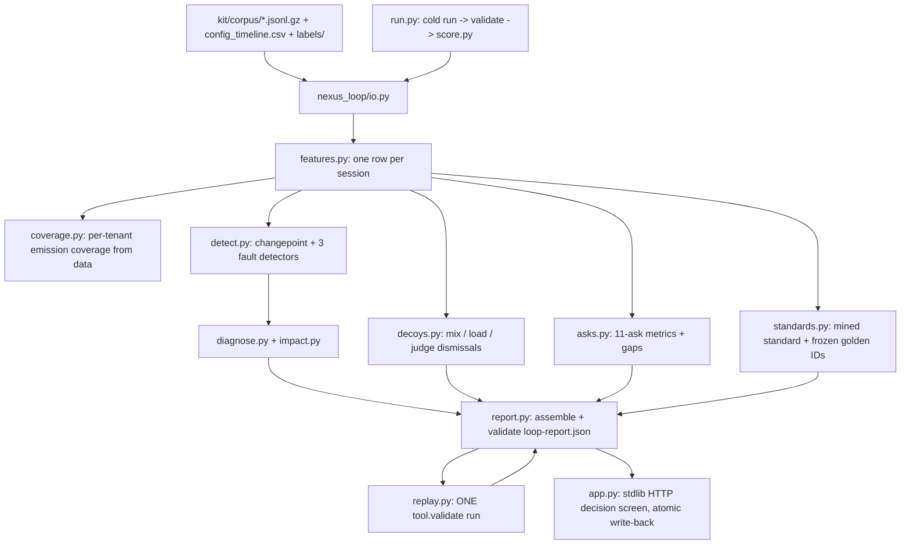

# Nexus Loop Implementation Plan

## What the review doc tells us to build

[docs/adversarial-review-nexus-loop-solution.md](docs/adversarial-review-nexus-loop-solution.md) §7 gives the shape: "session-level feature table from raw logs; three detector-specific analyses; explicit decoy outputs and A11; one complete KB or silent-tool loop; small report-driven UI; full-corpus cold run." Its §2/§6 corrections become hard implementation rules (see Guardrails below). The companion [docs/improved-solution-and-workflow.md](docs/improved-solution-and-workflow.md) already spells out the module split; this plan turns both into concrete files and steps.

The repo currently has **no implementation code** — only `kit/`, `tools/nexus-loop-kit/` (organiser tooling: `starter.py`, `score.py`, `replay/serve.py`, schema, examples) and docs. Everything below is greenfield. Python 3.12 is available, no third-party deps needed (matches kit convention).

## Architecture

## Layout to create

- `nexus_loop/` package: `io.py`, `features.py`, `coverage.py`, `metrics.py`, `cohorts.py`, `detect.py`, `decoys.py`, `standards.py`, `diagnose.py`, `impact.py`, `asks.py`, `report.py`, `validate.py`, `replay.py`, `app.py`, `static/index.html`
- `run.py` at repo root: `python3 run.py --kit kit --team <name> --out out/loop-report.json [--replay-url http://127.0.0.1:8719]`
- `out/` (gitignored) for the report, `golden_set.json`, `decisions.log`
- `docs/submission-note.md`: the one-page real / stubbed / simulated / breaks-at-100x note

## Phases

### Phase 1 — Ingest and session feature table (`io.py`, `features.py`, `coverage.py`)

- Stream gzipped JSONL; read `config_timeline.csv` (note `tenant='*'` for the judge change), `labels/*.jsonl`, `feedback.csv`.
- Ingest rule (review §3.3): validate required known keys per file, **preserve unknown fields**, fail clearly only if a needed field is missing. Do not quarantine.
- Build one dict per `session_id` from `sessions.jsonl.gz` (already carries `turns`, `cost_usd`, `session_end`, `handoff_by_design`, `tool_error_count`, `kb_miss_count`, `judge_version`, `quality_score`, `milestones_reached`), then a single pass over `agent_steps.jsonl.gz` adding step-derived fields reduced to session grain: `tool_call_count`, `empty_success_count` (status 200 + outcome ok + `result_field_count==0`), `empty_success_by_tool`, `same_tool_retry_count`, `tool_latency_ms` list, `kb_lookup_count`, `kb_hit_count`, `kb_top_scores`, `guardrail_block_count`. A few passes / in-memory maps are fine (review §3.4); 80k sessions fit.
- `coverage.py`: per tenant, `tool_coverage = sessions with >=1 tool_call / all sessions` (expect ~0.72 / ~0.93, must land within 0.03 for `score.py` C1), plus kb/cost/guardrail coverage computed the same way.

### Phase 2 — Metric helper and ask coverage map (`metrics.py`, `asks.py`)

- `metric(...)` constructor returning the schema shape with value, `fidelity`, `coverage{value,basis,excluded}`, `plan{source,filter,denominator,breakdowns}`, `calibration` — the "number passport" (review §1.3) built in, not bolted on.
- Answer all 11 asks with a metric or a gap; the four required (A01, A04, A09, A11) first:
  - A01 containment (measured, cov 1.0); A04 per-tenant tool failure rate (measured, v3-only coverage, `excluded: agent_kind=v2_flow`); also a derived `empty_success_rate` metric ("derivable_not_declared" per catalog).
  - A09: gap `REQUIRES_NEW_JUDGE` (abandonment measured, reason judged); no LLM judge in MVP.
  - A11: gap `NOT_MEASURABLE` with **exact** `required_event = {name: failover, grain: step, fields: [from_target, to_target, reason, recovered], owner: conversation-runtime}`, plus `nearest_proxy` = `llm_call.retry_count>0` and `why_the_proxy_misleads` (review §2.1).
  - A02 stratified by intent, A03 cost per resolved (v3 coverage), A05 milestone drop-off for `return_initiate`, A06 kb_hit/kb_top_score, A07 model-upgrade before/after within one judge_version, A08 spend = sum of recorded `cost_usd`, A10 deterministic review scope.
  - Judged `quality_score` metric with calibration computed from `labels/rubric_scores.jsonl` (e.g. within-1 agreement, segmented by judge_version, expected ≈0.95 — never 1.00).
  - C2: a `CARDINALITY_REFUSED` gap for any breakdown on `custom_dims.customer_ref`, citing the **fixed budget 200** from `catalog.cardinality_budgets` (review §2.5); never a relative threshold.

### Phase 3 — Fault detectors (`cohorts.py`, `detect.py`)

Shared primitive: config-anchored / robust changepoint on a per-day series for a cohort, with min window and effect size; candidates derived from data + config timeline, **no practice literals** (tenant/day/intent/tool/agent). Detector-specific dimensions per review §3.1:

- **Tool contract break** — slice `(tenant, tool_name, intent)`; per-day `empty_success_rate`; require ordinary `tool_error_rate` flat, resolution down / unplanned handoff up, same-tool retry present; attribute to nearest `kind=tool` change on that `target`. Do not hardcode 14%.
- **KB gap** — slice `(tenant, intent, agent_id)`; resolution far below a **same-tenant, same-window peer standard** of comparable KB-backed intents on the same agent (review §2.2 — never cross-tenant); mechanism `kb_hit≈0`, `kb_top_score` low; attribute to nearest `kind=kb` change (review §2.3 — the KB content-pack change *is* the candidate). Handle cohorts with no before-period.
- **Prompt/efficiency regression** — slice `(tenant, agent_id, prompt_version)`; median/mean turns and `cost_usd` up, resolution flat; **peer control** on sibling agents in the same tenant; attribute to nearest `kind=prompt` change with `target==agent_id`. Report the measured deltas, not "doubled" (review §2.4).
- Observation and attribution are separate (review §3.2): emit a regression with `cause_class: unknown` and `attributed_change: null` when mechanism is proven but no change aligns.

### Phase 4 — Decoy dismissals (`decoys.py`)

Emit `is_regression:false` findings **with a linked diagnosis** carrying the exact cause class (required by `score.py:134-141`):

- traffic mix → `traffic_mix`: aggregate containment moves, every per-intent rate flat, one intent's share jumps.
- load event → `load`: volume and tool p95 spike then revert; resolution/quality flat.
- judge boundary → `judge_change`: quality drops across both tenants at a `kind=judge` `tenant='*'` change; state comparisons are only within a `judge_version`.

### Phase 5 — Standard and golden set (`standards.py`)

Fixed, explicit rules (review §3.5, §4.2): pre-change or same-judge-version window; resolved and no unplanned handoff; exclude tool errors / KB misses where telemetry exists; top decile by turns = `best`, plus `median`, `deficit`, `exemplar_n`, `derivation`. Select 20–50 golden session IDs from the same tenant/agent family, outside the fault cohort, persist to `out/golden_set.json` **before** any prescription, never recompute after.

### Phase 6 — Diagnose, impact, report assembly (`diagnose.py`, `impact.py`, `report.py`, `validate.py`)

- Diagnoses: `cause_class` enum, `confidence`, `attributed_change{kind,day}` (within ±2 days for bonus), evidence strings.
- Impact: `conversations_affected`, `share_of_traffic` (of tenant traffic in window), `downstream{would_have_resolved_at_baseline, unplanned_handoffs, abandoned}`, `cost_usd` = sum of recorded cost or `null` (review §2.6 — no invented handoff dollars), `days_running`, one `derivation` string; `audience`, `if_nothing_changes`.
- Prescription for the primary finding: `change_type` from the accepted enum, `predicted_delta{metric,from,to}`, `decision{asking_approval_for, risk_if_diagnosis_wrong, would_not_ship_if}` (review §1.5).
- `validate.py`: stdlib check of the schema's required keys/enums/conditionals (use `jsonschema` if importable, else the built-in check); run before writing.

### Phase 7 — Replay client (`replay.py`)

Policy from review §4: diagnose offline, then **one** run on the strongest finding (silent-tool `tool.validate` on `get_order_status`, exact detected cohort `{intent, tool, from_day, to_day}`, frozen golden set). Record `run_id`, `before`, `after`, `golden_set_pass`, `verdict`, `prediction_error` honestly; `no_effect` is a result. Optional second/third genuine runs (`kb.add`, `prompt.edit` with `agent_id` cohort key) only to make `self_assessment.cycles` truthful; otherwise report `cycles: 1` and say so in `system_notes`. Skip gracefully (no verification, report still valid) if `--replay-url` is unreachable.

### Phase 8 — Decision screen (`app.py`, `static/index.html`)

Stdlib `http.server`; renders **only** from `out/loop-report.json` (review §1.2). Default view = primary verified finding: headline/severity, cohort + impact, baseline and why fair, evidence + config change, prescription, risk / no-ship, replay before/after + golden result, approve / reject / defer with mandatory reason. Compact "other observations" area for the three dismissals and the A11 refusal. `POST /decision`: read → update only that prescription's `approval{verdict,decided_by,reason,at}` → temp file → atomic replace → re-validate → append `out/decisions.log` (review §5).

### Phase 9 — Cold run and submission (`run.py`, `docs/submission-note.md`)

- `run.py`: load kit → features → metrics/asks → detectors → decoys → standards → diagnoses/impact → optional replay → validate → write → invoke `score.py` when a ground truth exists.
- Verify on `kit/corpus_sample` for speed, then full `kit/corpus`; target all 3 faults with correct cohort keys and cause classes, 3 CLEAN decoys, honesty items (fidelity+coverage on every metric, tool coverage within tolerance, calibration <0.995, A11 spec), one real `rp_` verification — approx. 55/55 on practice ground truth.
- Write the one-page note (real / stubbed / simulated / breaks at 100x) and add `out/` to `.gitignore`.

## Guardrails (from the review — enforce in code review of each phase)

- Reject: `failover_triggered` event spec; cross-tenant intent-family baseline; "KB issue has no config candidate"; "doubled" prompt claims; null/wrong replay calibration runs; calibration ceiling claims; quarantining unknown fields; `customer_ref` as join key (safe key is `session_id`); CI/hash theatre.
- Borrow: report as single source of truth; number passport on every metric; explicit dismissals; A11 early; deterministic-first (no LLM for logged facts); one unattended command; depth only on the replay chain.
- Never reference `experiments/loop-report.55.json` as output; it is a shape reference only.
