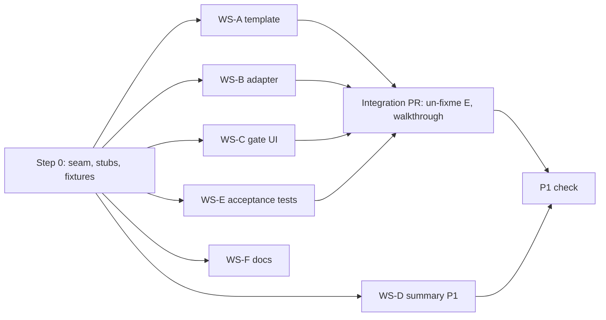

# PRD: Signed copy

A hand-off note the manager can paste after recording a verdict.

| | |
|---|---|
| Product | Nexus Loop operator desk (`nexus_loop/static/index.html`) |
| Feature | Signed copy (P0) and All-decisions summary (P1) |
| PRD owner | Mehul |
| Version | 1.0 (17 Sep 2026) |
| Status | Ready for build |
| Read before this | `handoff.md` (operator desk psychology), then this PRD end to end |

---

## 0. How agents use this PRD

This PRD is built for **parallel development**. After one short serial step
(Step 0), six workstreams run at the same time without editing the same files.
That only works if every agent follows these rules.

1. **Read `handoff.md` in full before writing code.** It explains who the user
   is and why the desk looks the way it does. Section 9 of that file lists the
   "improvements" that break the product. This feature must not do any of them.
2. **Stay inside the files you own** (see §8.3). If you need a change in a file
   you do not own, write it under *Requests for other workstreams* in your PR
   description. Do not make the edit yourself.
3. **§6 (contracts) and §7 (fixtures and goldens) are frozen.** If a contract is
   wrong or missing something, stop, record it under *Contract gaps* in your PR
   description, and do not build anything on a guessed change. Only the PRD
   owner changes contracts (§12).
4. **Never compute, round, parse or reformat a number.** New code never reads raw
   report values. It reads display strings through the `NexusDesk` seam (§6.2),
   which returns exactly what the screen already shows.
5. **Never refactor, rename or restyle existing desk code.** Step 0 adds a seam.
   Nobody else edits `index.html`.
6. **Keep main shippable.** Every stub returns `null`, and the UI renders nothing
   when anything upstream returns `null`. Any merge order leaves the desk
   working, with the feature invisible until all of its parts have landed.
7. **If `handoff.md` and the live HTML disagree, the HTML is right** (as
   `handoff.md` itself says). Record the disagreement in your PR.
8. **Every PR lists** the R-IDs (§5) and G-IDs (§9) it satisfies, and confirms
   that its tests pass.
9. **Branch names:** `sc/step0-seam`, `sc/ws-a-template`, `sc/ws-b-adapter`,
   `sc/ws-c-ui`, `sc/ws-d-summary`, `sc/ws-e-acceptance`, `sc/ws-f-docs`.

---

## 1. Summary

When a manager records Accept, Reject or Defer on a **Needs attention** finding,
the gate offers a single control: **Copy signed copy**. It copies a plain-text
note built from a fixed template. The template is filled only with strings the
screen already shows, plus the recorded decision. The manager pastes the note
wherever the owning team works, or sends it to their own boss.

P1 adds **Copy all decisions**. Once every Needs attention finding has a recorded
decision, this copies one note that covers all of them, plus the dismissed
signals and the refusals.

## 2. Problem

The desk gets a non-technical manager to a reasoned signature. It does nothing
for their next task, which is telling the owner. Today that means retyping,
taking a screenshot, or forwarding a bare link. Each of these fails in a way
`handoff.md` already warns about:

- **Retyping creates a second source of truth.** "2,686" becomes "about 2,700"
  in chat, and the owner acts on the paraphrase.
- **Honesty gets lost in transit.** The "simulated baseline" qualifier falls off
  the replay number, and the coverage caveat disappears.
- **The owner can't find the finding.** A manager-English paraphrase carries no
  technical names and no deep link.
- **A Reject travels as "they said no".** The owner doesn't learn that the
  finding is still open and still their problem.

## 3. Goals and non-goals

### Goals

| # | Goal |
|---|---|
| Goal 1 | Go from a recorded verdict to the clipboard in one click. |
| Goal 2 | The pasted note answers the eight questions from `handoff.md` §1.2, in the page's order, with values identical to the screen. |
| Goal 3 | Honesty survives the paste: the reason word for word, the simulated-baseline qualifier, coverage text, technical names and a deep link. |
| Goal 4 | The decision moment doesn't change. Nothing new appears before a verdict is recorded. |
| Goal 5 | Every verdict gets equal service. Reject and Defer notes are as useful as Accept notes. |

### Non-goals (do not build)

- A note, button or summary on **Dismissed signals** or **No measurement** rows.
- Any server change, new endpoint, new write, or extra field in the POST body.
- A mailto link, a Slack or email integration, a "Send" button, or any claim that
  the note was delivered.
- LLM-written or free-text summaries. The note is a fixed template (§6.4).
- An editable note inside the desk. The preview is read-only, and the manager
  can edit the text after pasting it.
- Analytics or telemetry.
- Any change to the Accept, Reject or Defer buttons, the reason field, the mode
  bar, the list or the story.
- Number formatting, rounding, unit conversion or relative dates.

## 4. The user and the moment

This is the same manager described in `handoff.md` §1: not fluent with tech,
reading on a Monday morning, anxious about being wrong, and signing a change
ticket. The Signed copy belongs to **the minute after the signature** and must
not leak into the minutes before it. If the note were visible before the verdict,
writing the message would become part of deciding, and whichever verdict
produced the nicer note would pull the manager toward it.

How the feature supports the judging rubric in `handoff.md` §10:

| Rubric | How the feature helps |
|---|---|
| Decision quality | The owner hand-off carries the harm, the owner, the risk, the cost of inaction and the written reason, straight from the one write path. |
| The screen | One quiet control appears after the signature. Nothing else changes. |
| Framing | The simulated replay, coverage, lookalikes and refusals stay visible outside the desk (the refusals and lookalikes via the P1 summary). |

---

## 5. Requirements

### 5.1 P0: Signed copy (per finding)

| ID | Requirement |
|---|---|
| R1 | The Signed copy renders only when the selected finding is in the `open` bucket (Needs attention) **and** its recorded decision is present in the most recently loaded `/report.json`. |
| R2 | It never renders before a decision exists in the loaded report. That covers a pending POST, a failed POST, and the time before the post-save re-fetch completes. |
| R3 | The note is built from `NexusDesk` display strings and the recorded decision in the loaded report. It is never built from the reason textarea's local value, and never from anything computed in the browser. |
| R4 | All three verdicts get a note. The control's label, size, position and style are identical for all three. |
| R5 | There is one primary action, **Copy signed copy**. One click takes the note from the recorded verdict to the clipboard. |
| R6 | A read-only preview sits under a disclosure (**See the note**) that is closed by default. |
| R7 | On success, a persistent inline status shows `COPY.ui.copied`. On failure (clipboard missing or rejected), the preview opens, the note text is focused and fully selected, and the status shows `COPY.ui.copyFailed`. No toasts and no timers. |
| R8 | The status resets when the selection changes or a different decision is recorded. It survives a gate re-render for the same decision. |
| R9 | The control is visually secondary: smaller than the verdict buttons, neutral or subtle, in inherited Source Sans 3, with no green, red or brand-blue fill. It uses only existing CSS tokens. It must not change the size or position of the verdict buttons or the recorded-verdict display. |
| R10 | The feature makes no new network requests and no new writes. |
| R11 | The note text comes from the fixed template in §6.4 only. |
| R12 | Replay numbers always carry the simulated-baseline qualifier. Coverage text is included whenever the desk shows it. |
| R13 | Technical names appear only in the note's footer. |
| R14 | The control can be reached with Tab. The list's existing ArrowUp, ArrowDown, Home and End behaviour is unchanged, and those keys don't move the list while focus is inside the preview textarea. |
| R15 | The deep link uses the desk's existing hash format (for example `#f01_…`), through `NexusDesk.findingUrl`. |

### 5.2 P1: All-decisions summary

| ID | Requirement |
|---|---|
| R16 | When **every** finding in the `open` bucket has a recorded decision, the gate on any `open` finding also shows **Copy all decisions** below the Signed copy. It never appears on `ignored` or `refused` rows. |
| R17 | The summary lists each decision in list order, then the dismissed-signals count (the same string the mode bar shows), then the refusal claims in list order, with A11 first. |
| R18 | The summary follows the same preview, status, failure and persistence behaviour as R6–R8, using the `COPY.ui.summary*` strings. |

### 5.3 How the note maps to the eight questions

Do **not** number or label the questions in the note (see `handoff.md` §1.2).
The mapping is shown here only so reviewers can check coverage.

| Note line | Question it answers |
|---|---|
| What broke | What broke? How bad is it? |
| Who was affected | Who was affected? |
| Why we think so | Why do we think it happened? |
| Owner | Who needs to fix it? |
| What we're changing / What was proposed | What are we asking permission to change? |
| If the diagnosis is wrong | What could go wrong if the diagnosis is wrong? |
| Replay test | Did the replay test say the fix helped? |
| If nothing changes | Cost of inaction (`handoff.md` §1.4, loss aversion) |
| My reason / What I'm waiting for | The signature itself |

---

## 6. Contracts (frozen)

### 6.1 Files and namespace

All new code lives in `nexus_loop/static/signed-copy/`. Each module is a classic
script that attaches one key to `window.SignedCopy`, and it can also be
`require`d by `node --test`.

| File | Global | Exports |
|---|---|---|
| `contract.js` | `SignedCopy.contract` | `COPY`, `present(s)`, `clean(s)`, `bare(s)`, `fill(template, values)`, `normalizeVerdict(raw)` |
| `template.js` | `SignedCopy.template` | `buildSignedCopy(input) → string` |
| `adapter.js` | `SignedCopy.adapter` | `toSignedCopyInput(desk, finding) → SignedCopyInput \| null` |
| `summary.js` | `SignedCopy.summary` | `toSummaryInput(desk) → DecisionsSummaryInput \| null`, `buildDecisionsSummary(input) → string` |
| `ui.js` | `SignedCopy.ui` | `render(slotEl, finding, deps?) → void` |
| `signed-copy.css` | — | Styles for §6.6 only |

Module wrapper (required pattern):

```js
(function (root, factory) {
  if (typeof module === 'object' && module.exports) {
    module.exports = factory(require('./contract.js'));
  } else {
    root.SignedCopy = root.SignedCopy || {};
    root.SignedCopy.template = factory(root.SignedCopy.contract); // use your own key
  }
})(typeof self !== 'undefined' ? self : globalThis, function (contract) {
  'use strict';
  // ...
  return { buildSignedCopy };
});
```

`contract.js` uses the same wrapper with no dependency. Load order in
`index.html` (added by Step 0) is `contract.js`, `template.js`, `summary.js`,
`adapter.js`, `ui.js`, all before the desk's existing inline script.

### 6.2 The desk seam: `window.NexusDesk`

Step 0 adds this read-only object at the end of the desk's existing script.
Every method wraps code the desk **already** uses to render the screen, and
returns the string exactly as displayed, or `null` when the screen shows
nothing for that field. No method computes a new value.

```js
window.NexusDesk = Object.freeze({
  // navigation and state
  selectedFinding(),            // the finding currently in the story
  bucketOf(finding),            // 'open' | 'ignored' | 'refused'
  findingsIn(bucket),           // findings in the order the left list shows them
  bucketCountText(bucket),      // count string the mode bar shows, e.g. "3"
  findingUrl(finding),          // absolute desk URL with the existing hash deep link
  runLabelText(),               // run or report label shown on the desk, or null

  // story strings, verbatim as rendered
  claimText(finding),           // story heading / claim
  metricLabel(finding),         // e.g. "Share we finished"
  observedText(finding),        // e.g. "77.5%"
  expectedText(finding),        // e.g. "85.5%"
  affectedFigureText(finding),  // the "conversations affected" KPI figure, e.g. "2,686"
  causeText(finding),
  configChangeText(finding),
  changeTargetText(finding),
  changeDescriptionText(finding),
  replayText(finding),          // { before, after } or null when the story says "No test this run."
  riskText(finding),
  ifNothingChangesText(finding),
  ownerText(finding),           // e.g. "Agent team needs to act"
  technicalNames(finding),      // string[] as listed under Technical names
  coverageText(),               // coverage chip text, or null
  refusalClaims(),              // string[]: claims of 'refused' rows in list order (A11 first)

  // decisions: from the most recently loaded /report.json only
  decisionFor(finding),         // { verdict, reason, recordedAtText } or null
                                // must be the same decision the gate displays as recorded
});
```

Step 0 fills in the **Seam inventory** (Appendix A) with the existing function
or expression behind each method.

### 6.3 Input types

```js
/**
 * @typedef {'accept'|'reject'|'defer'} Verdict
 *
 * @typedef {Object} SignedCopyInput
 * @property {Verdict} verdict
 * @property {string} findingTitle
 * @property {string} reason                 // recorded reason, verbatim
 * @property {string} findingUrl
 * @property {string|null} metricLabel
 * @property {string|null} observed
 * @property {string|null} expected
 * @property {string|null} affected          // figure only, e.g. "2,686"
 * @property {string|null} cause
 * @property {string|null} configChange
 * @property {string|null} changeTarget
 * @property {string|null} changeDescription
 * @property {{before: string, after: string}|null} replay
 * @property {string|null} risk
 * @property {string|null} ifNothingChanges
 * @property {string|null} ownerLine
 * @property {string[]} technicalNames
 * @property {string|null} recordedAt
 * @property {string|null} coverageText
 *
 * @typedef {Object} DecisionsSummaryInput
 * @property {string|null} runLabel
 * @property {Array<{verdict: Verdict, findingTitle: string, reason: string, findingUrl: string}>} decided  // list order
 * @property {string|null} dismissedCount    // mode bar count text, e.g. "4"
 * @property {string[]} refusals             // list order, A11 first
 */
```

### 6.4 Rendering rules

#### Helpers (in `contract.js`)

```js
function present(s) { return typeof s === 'string' && s.trim() !== ''; }
function clean(s)   { return present(s) ? s.trim() : null; }
function bare(s)    { const t = clean(s); return t === null ? null : t.replace(/\.$/, ''); }
function fill(template, values) {
  // Single pass; values are inserted literally (function replacer avoids `$&` patterns).
  return template.replace(/\{(\w+)\}/g, (m, key) => {
    if (!(key in values)) throw new Error('fill: missing ' + key);
    return values[key];
  });
}
```

No other text processing is allowed: no case changes, no truncation, no number
parsing and no locale formatting.

#### Field treatment

| Field | Treatment |
|---|---|
| `reason` | Inserted **verbatim**, with no trim. Internal quotes and newlines are kept. |
| `findingTitle`, `findingUrl`, `metricLabel`, `observed`, `expected`, `affected`, `replay.before`, `replay.after`, each technical name, `recordedAt`, `coverageText`, summary titles, URLs, `runLabel`, `dismissedCount` | `clean()` |
| `changeTarget`, `changeDescription`, `cause`, `configChange`, `risk`, `ifNothingChanges`, `ownerLine`, each refusal claim | `bare()` (templates supply the final period) |

#### Lines of the per-finding note

| Key | Emitted when | Template (`COPY.note.*`) |
|---|---|---|
| headline | always | `[verdict].headline` if `present(changeTarget)`, else `[verdict].headlineNoTarget` |
| finding | always | `finding` |
| reason | always | `reason`, with `label` = `[verdict].reasonLabel` |
| stillOpen | reject only | `reject.stillOpen` |
| whatBroke | `metricLabel`, `observed` and `expected` all present | `whatBroke` |
| affected | `affected` present | `affected` |
| why | both → `whyBoth`; cause only → `whyCause`; config only → `whyConfig`; neither → omit | |
| change | both → `changeBoth`; target only → `changeTarget`; description only → `changeDescription`; neither → omit. `label` = `[verdict].changeLabel` | |
| replay | `replay` is non-null and both values present → `replay`; otherwise → `replayNone` | |
| risk | `risk` present | `risk` |
| ifNothingChanges | present | `ifNothingChanges` |
| owner | `ownerLine` present | `owner` |
| open | always | `open` |
| technicalNames | at least one present name (drop blank names) | `technicalNames`, names joined with `technicalNamesSeparator` |
| meta | `recordedAt` and/or `coverageText` present | parts `[fill(recorded), coverageText]` (present ones only) joined with `metaSeparator` |

#### Block order

Lines inside a block are joined with `\n`, and blocks with `\n\n`. Omitted
lines are dropped, empty blocks are dropped, and there is **no trailing
newline**. The output never has two blank lines in a row.

| Verdict | Block 1 | Block 2 | Block 3 | Block 4 | Block 5 |
|---|---|---|---|---|---|
| accept | headline, finding | reason | whatBroke, affected, why, change, replay, risk, ifNothingChanges, owner | open, technicalNames, meta | — |
| defer | headline, finding | reason | whatBroke, affected, why, change, replay, risk, ifNothingChanges, owner | open, technicalNames, meta | — |
| reject | headline, finding | reason | stillOpen, ifNothingChanges, owner | whatBroke, affected, why, change, replay, risk | open, technicalNames, meta |

#### Validation

`buildSignedCopy` throws `TypeError` when `verdict` is not one of the three
values, when `findingTitle` or `findingUrl` is not `present`, or when `reason`
is not `present`. The adapter guarantees none of these reach the template.

#### Summary note (P1)

| Block | Content |
|---|---|
| 1 | `summary.titleWithRun` if `runLabel` present, else `summary.title` |
| 2…n | One block per decided item, in order: `summary.[verdict]`; then `summary.waitingFor` for defer or `summary.reason` otherwise; then `summary.open` |
| last | `dismissedOne` if `dismissedCount === "1"`; `dismissedMany` if it's present and not `"0"`; omitted otherwise. Then `refusals` (claims `bare()`d and joined with `refusalsSeparator`) if there is at least one claim. Omit the block when both lines are omitted. |

`buildDecisionsSummary` throws `TypeError` when `decided` is empty or any item
fails the per-finding validation above.

### 6.5 Copy strings

These are frozen and live in `contract.js`. Tests and docs import or quote
them. Never retype them.

File: `nexus_loop/static/signed-copy/contract.js` (COPY)

```js
const COPY = Object.freeze({
  note: {
    accept: {
      headline: 'Accepted: go ahead with the change to {target}.',
      headlineNoTarget: 'Accepted: go ahead with this change.',
      reasonLabel: 'My reason',
      changeLabel: "What we're changing",
    },
    reject: {
      headline: 'Rejected: do not make the change to {target}.',
      headlineNoTarget: 'Rejected: do not make this change.',
      reasonLabel: 'My reason',
      changeLabel: 'What was proposed',
      stillOpen: 'Rejecting the change does not close this finding.',
    },
    defer: {
      headline: 'Not decided yet: the change to {target} is on hold.',
      headlineNoTarget: 'Not decided yet: this change is on hold.',
      reasonLabel: "What I'm waiting for",
      changeLabel: 'What was proposed',
    },
    finding: 'Finding: {title}',
    reason: '{label}: "{reason}"',
    whatBroke: 'What broke: {metric} is {observed}, expected {expected}.',
    affected: 'Who was affected: {affected} conversations.',
    whyBoth: 'Why we think so: {cause}, after {configChange}.',
    whyCause: 'Why we think so: {cause}.',
    whyConfig: 'Why we think so: it started after {configChange}.',
    changeBoth: '{label}: {target}: {description}.',
    changeTarget: '{label}: {target}.',
    changeDescription: '{label}: {description}.',
    replay: "Replay test: {before} → {after} (before is the test's simulated baseline, not live traffic).",
    replayNone: 'Replay test: No test this run.',
    risk: 'If the diagnosis is wrong: {risk}.',
    ifNothingChanges: 'If nothing changes: {ifNothingChanges}.',
    owner: 'Owner: {owner}.',
    open: 'Open this finding: {url}',
    technicalNames: 'Technical names: {names}',
    technicalNamesSeparator: ' · ',
    recorded: 'Recorded {recordedAt}',
    metaSeparator: ' · ',
  },
  summary: {
    title: 'Decisions',
    titleWithRun: 'Decisions for {run}',
    accept: 'Accepted: {title}',
    reject: 'Rejected: {title}',
    defer: 'Not decided yet: {title}',
    reason: 'Reason: "{reason}"',
    waitingFor: 'Waiting for: "{reason}"',
    open: 'Open: {url}',
    dismissedOne: 'Dismissed signals: 1 looked like a problem and is not.',
    dismissedMany: 'Dismissed signals: {count} looked like problems and are not.',
    refusals: 'No measurement: {claims}.',
    refusalsSeparator: '; ',
  },
  ui: {
    button: 'Copy signed copy',
    preview: 'See the note',
    copied: 'Copied. Paste it wherever the owning team works.',
    copyFailed: 'Could not copy automatically. The note is selected below. Copy it from there.',
    summaryButton: 'Copy all decisions',
    summaryPreview: 'See all decisions',
    summaryCopied: 'Copied all decisions.',
    summaryCopyFailed: 'Could not copy automatically. All decisions are selected below. Copy them from there.',
  },
});
```

### 6.6 DOM contract

`ui.render` produces exactly this structure inside the slot that Step 0 adds
below the recorded-verdict display in the gate. Class names are free, but
`data-testid`, roles and ARIA are fixed.

```html
<section data-testid="signed-copy" aria-label="Signed copy">
  <button type="button" data-testid="signed-copy-button">Copy signed copy</button>
  <p data-testid="signed-copy-status" role="status" aria-live="polite"></p>
  <details data-testid="signed-copy-preview">
    <summary>See the note</summary>
    <textarea data-testid="signed-copy-text" readonly rows="14"></textarea>
  </details>
</section>

<!-- P1, rendered after the section above when R16 holds -->
<section data-testid="decisions-summary" aria-label="All decisions">
  <button type="button" data-testid="decisions-summary-button">Copy all decisions</button>
  <p data-testid="decisions-summary-status" role="status" aria-live="polite"></p>
  <details data-testid="decisions-summary-preview">
    <summary>See all decisions</summary>
    <textarea data-testid="decisions-summary-text" readonly rows="14"></textarea>
  </details>
</section>
```

`ui.render(slotEl, finding, deps)` rules:

- `deps` defaults to `{ desk: window.NexusDesk, adapter: SignedCopy.adapter, template: SignedCopy.template, summary: SignedCopy.summary, clipboard: navigator.clipboard, copy: SignedCopy.contract.COPY }`. Tests inject fakes.
- It is synchronous and idempotent. It clears the slot, then renders. It starts no timers.
- If the adapter returns `null`, or the template returns something that isn't a string, the slot stays empty (this is what keeps main shippable while stubs are in place).
- Status persistence key: `findingUrl | verdict | recordedAt | reason`. It is kept in module state, so a re-render for the same key shows `copied` again, and a new key shows an empty status.
- On click, it `await`s `deps.clipboard.writeText(text)`. If that throws or the clipboard is missing, it opens the preview, focuses the textarea, calls `select()`, and shows `copyFailed`.
- The textarea uses `font-family: inherit` and keeps whitespace.

---

## 7. Fixtures and golden outputs

All fixture values are **synthetic**. They exist to pin the template's behaviour
and must never be copied into the UI. Step 0 commits every file below verbatim.
Golden files are stored without a trailing newline. Tests should compare with
`read(...).replace(/\n$/, '')` so an editor-added newline doesn't cause a false
failure.

Coverage of the rules:

| Fixture | Exercises |
|---|---|
| accept | Every line present; `bare()` on a cause that ends in a period; full footer |
| reject | Reject block order; `replayNone`; meta line with `recordedAt` only |
| defer | `headlineNoTarget`; `whyCause`; `changeDescription` only; no risk; no technical names; meta with coverage only |
| summary | All three verdict labels; `dismissedMany`; `bare()` on a refusal claim |

### 7.1 Accept

File: `tests/signed_copy/fixtures/accept.input.json`

```json
{
  "verdict": "accept",
  "findingTitle": "Silent tool failure: the tool said success but sent an empty answer",
  "reason": "Harm is large and the replay improved. The agent team can undo it if it misfires.",
  "findingUrl": "http://localhost:8000/#f01_tool_contract_break",
  "metricLabel": "Share we finished",
  "observed": "77.5%",
  "expected": "85.5%",
  "affected": "2,686",
  "cause": "The order lookup tool reported success but returned nothing.",
  "configChange": "the tool's response format was changed",
  "changeTarget": "the order lookup instructions",
  "changeDescription": "treat an empty answer as a failure and ask the customer to try again",
  "replay": { "before": "76.0%", "after": "84.5%" },
  "risk": "customers may get an extra retry message and nothing improves",
  "ifNothingChanges": "customers in this group keep leaving without an answer",
  "ownerLine": "Agent team needs to act",
  "technicalNames": ["tool.contract_break", "resolution_rate"],
  "recordedAt": "14 Sep 2026, 09:42",
  "coverageText": "Coverage: 100% of sessions"
}
```

File: `tests/signed_copy/fixtures/accept.golden.txt`

```text
Accepted: go ahead with the change to the order lookup instructions.
Finding: Silent tool failure: the tool said success but sent an empty answer

My reason: "Harm is large and the replay improved. The agent team can undo it if it misfires."

What broke: Share we finished is 77.5%, expected 85.5%.
Who was affected: 2,686 conversations.
Why we think so: The order lookup tool reported success but returned nothing, after the tool's response format was changed.
What we're changing: the order lookup instructions: treat an empty answer as a failure and ask the customer to try again.
Replay test: 76.0% → 84.5% (before is the test's simulated baseline, not live traffic).
If the diagnosis is wrong: customers may get an extra retry message and nothing improves.
If nothing changes: customers in this group keep leaving without an answer.
Owner: Agent team needs to act.

Open this finding: http://localhost:8000/#f01_tool_contract_break
Technical names: tool.contract_break · resolution_rate
Recorded 14 Sep 2026, 09:42 · Coverage: 100% of sessions
```

### 7.2 Reject

File: `tests/signed_copy/fixtures/reject.input.json`

```json
{
  "verdict": "reject",
  "findingTitle": "Silent tool failure: the tool said success but sent an empty answer",
  "reason": "The retry message would reach every customer, not just this group. Too broad for the harm shown.",
  "findingUrl": "http://localhost:8000/#f01_tool_contract_break",
  "metricLabel": "Share we finished",
  "observed": "77.5%",
  "expected": "85.5%",
  "affected": "2,686",
  "cause": "The order lookup tool reported success but returned nothing.",
  "configChange": "the tool's response format was changed",
  "changeTarget": "the order lookup instructions",
  "changeDescription": "treat an empty answer as a failure and ask the customer to try again",
  "replay": null,
  "risk": "customers may get an extra retry message and nothing improves",
  "ifNothingChanges": "customers in this group keep leaving without an answer",
  "ownerLine": "Agent team needs to act",
  "technicalNames": ["tool.contract_break", "resolution_rate"],
  "recordedAt": "14 Sep 2026, 09:42",
  "coverageText": null
}
```

File: `tests/signed_copy/fixtures/reject.golden.txt`

```text
Rejected: do not make the change to the order lookup instructions.
Finding: Silent tool failure: the tool said success but sent an empty answer

My reason: "The retry message would reach every customer, not just this group. Too broad for the harm shown."

Rejecting the change does not close this finding.
If nothing changes: customers in this group keep leaving without an answer.
Owner: Agent team needs to act.

What broke: Share we finished is 77.5%, expected 85.5%.
Who was affected: 2,686 conversations.
Why we think so: The order lookup tool reported success but returned nothing, after the tool's response format was changed.
What was proposed: the order lookup instructions: treat an empty answer as a failure and ask the customer to try again.
Replay test: No test this run.
If the diagnosis is wrong: customers may get an extra retry message and nothing improves.

Open this finding: http://localhost:8000/#f01_tool_contract_break
Technical names: tool.contract_break · resolution_rate
Recorded 14 Sep 2026, 09:42
```

### 7.3 Defer

File: `tests/signed_copy/fixtures/defer.input.json`

```json
{
  "verdict": "defer",
  "findingTitle": "Silent tool failure: the tool said success but sent an empty answer",
  "reason": "Need the agent team to confirm when the tool format changed before I sign.",
  "findingUrl": "http://localhost:8000/#f01_tool_contract_break",
  "metricLabel": "Share we finished",
  "observed": "77.5%",
  "expected": "85.5%",
  "affected": "2,686",
  "cause": "The order lookup tool reported success but returned nothing.",
  "configChange": null,
  "changeTarget": null,
  "changeDescription": "treat an empty answer as a failure and ask the customer to try again",
  "replay": { "before": "76.0%", "after": "84.5%" },
  "risk": null,
  "ifNothingChanges": "customers in this group keep leaving without an answer",
  "ownerLine": "Agent team needs to act",
  "technicalNames": [],
  "recordedAt": null,
  "coverageText": "Coverage: 100% of sessions"
}
```

File: `tests/signed_copy/fixtures/defer.golden.txt`

```text
Not decided yet: this change is on hold.
Finding: Silent tool failure: the tool said success but sent an empty answer

What I'm waiting for: "Need the agent team to confirm when the tool format changed before I sign."

What broke: Share we finished is 77.5%, expected 85.5%.
Who was affected: 2,686 conversations.
Why we think so: The order lookup tool reported success but returned nothing.
What was proposed: treat an empty answer as a failure and ask the customer to try again.
Replay test: 76.0% → 84.5% (before is the test's simulated baseline, not live traffic).
If nothing changes: customers in this group keep leaving without an answer.
Owner: Agent team needs to act.

Open this finding: http://localhost:8000/#f01_tool_contract_break
Coverage: 100% of sessions
```

### 7.4 Summary (P1)

File: `tests/signed_copy/fixtures/summary.input.json`

```json
{
  "runLabel": null,
  "decided": [
    {
      "verdict": "accept",
      "findingTitle": "Silent tool failure: the tool said success but sent an empty answer",
      "reason": "Harm is large and the replay improved. The agent team can undo it if it misfires.",
      "findingUrl": "http://localhost:8000/#f01_tool_contract_break"
    },
    {
      "verdict": "reject",
      "findingTitle": "Handoffs to a person dropped after the greeting change",
      "reason": "The proposed wording hides the handoff option. Ask for a smaller change.",
      "findingUrl": "http://localhost:8000/#f02_handoff_rate"
    },
    {
      "verdict": "defer",
      "findingTitle": "Refund answers got longer",
      "reason": "Need to know whether customers finished faster before I sign.",
      "findingUrl": "http://localhost:8000/#f03_answer_length"
    }
  ],
  "dismissedCount": "4",
  "refusals": ["We will not invent a failover rate", "We will not invent this number."]
}
```

File: `tests/signed_copy/fixtures/summary.golden.txt`

```text
Decisions

Accepted: Silent tool failure: the tool said success but sent an empty answer
Reason: "Harm is large and the replay improved. The agent team can undo it if it misfires."
Open: http://localhost:8000/#f01_tool_contract_break

Rejected: Handoffs to a person dropped after the greeting change
Reason: "The proposed wording hides the handoff option. Ask for a smaller change."
Open: http://localhost:8000/#f02_handoff_rate

Not decided yet: Refund answers got longer
Waiting for: "Need to know whether customers finished faster before I sign."
Open: http://localhost:8000/#f03_answer_length

Dismissed signals: 4 looked like problems and are not.
No measurement: We will not invent a failover rate; We will not invent this number.
```

---

## 8. Parallel build plan

### 8.1 Step 0: Seam and scaffolding (serial, blocks everything)

**Owner:** lead agent (one agent only). **Branch:** `sc/step0-seam`.

| # | Task |
|---|---|
| 0.1 | Read `handoff.md` and `index.html`. Fill in Appendix A (the Seam inventory) in this PRD. Only the "Existing source" and "Notes" columns may be edited. |
| 0.2 | Append `window.NexusDesk` (§6.2) to the end of the existing inline script. Additive only: each method wraps an existing function or expression, with no renames and no behaviour change. |
| 0.3 | Confirm how static assets are served. Add `<link>` for `signed-copy/signed-copy.css` and the five `<script>` tags (load order §6.1) using that path style. If sibling files aren't served, apply the Q3 fallback in §11 and tell the PRD owner before fan-out. |
| 0.4 | In the gate renderer, for the `open` bucket only, add `<div data-testid="signed-copy-slot"></div>` directly below the recorded-verdict display, and call `window.SignedCopy?.ui?.render(slotEl, finding)` every time the gate renders. |
| 0.5 | Create `contract.js` with `COPY` (§6.5, verbatim), the helpers (§6.4, verbatim) and a working `normalizeVerdict(raw)`. The mapping comes from the verdict values the report and the POST contract actually use. Unknown values map to `null`. |
| 0.6 | Create stubs for `template.js`, `adapter.js`, `summary.js` and `ui.js`, using the §6.1 wrapper and exact export names. Every function returns `null` (`ui.render` clears the slot). Create an empty `signed-copy.css`. |
| 0.7 | Commit all fixtures and goldens from §7 verbatim. |
| 0.8 | Add the test runners if the repo has none: `node --test` for unit tests, Playwright for e2e. Document how to start the desk against a **temporary copy** of the report and decision store (see Q7) in `tests/signed_copy/README.md`. |
| 0.9 | Add `tests/signed_copy/unit/contract.test.js` covering `present`, `clean`, `bare`, `fill` (including a value containing `$&`) and `normalizeVerdict`. |
| 0.10 | Capture the baseline screenshot for G9: the gate for the default undecided Needs attention finding, taken on the commit **before** Step 0. Save it as `tests/signed_copy/baseline/gate-undecided.png`. |

**Done when:** it is merged to main, existing behaviour and screenshots are
unchanged, the contract tests pass, and Appendix A has no blank rows.

### 8.2 Workstreams (start together once Step 0 is merged)

#### WS-A: Note template

| | |
|---|---|
| Owns | `nexus_loop/static/signed-copy/template.js`, `tests/signed_copy/unit/template.test.js` |
| Reads only | §6.3–6.5, §7.1–7.3, `contract.js` |
| Builds | `buildSignedCopy(input)` exactly as specified in §6.4 |
| Must test | The three goldens, byte for byte. Edge cases: `changeTarget` null for every verdict; cause-only, config-only and neither; target-only and description-only change; `replay` with a blank `after` renders `replayNone`; a reason containing `"`, `$&` and a newline is kept verbatim; blank technical names are dropped; every optional field null still yields headline, finding, reason, `replayNone` and open; each validation `TypeError`; no line has trailing spaces; there are no double blank lines and no trailing newline. |
| Must not | Touch the DOM or `NexusDesk`, read globals other than `contract`, or parse numbers. |
| Done when | All tests pass and G7 passes for `template.js`. |

#### WS-B: Adapter

| | |
|---|---|
| Owns | `nexus_loop/static/signed-copy/adapter.js`, `tests/signed_copy/unit/adapter.test.js` |
| Reads only | §6.2–6.3, Appendix A, `contract.js` |
| Builds | `toSignedCopyInput(desk, finding)`: (1) return `null` unless `desk.bucketOf(finding) === 'open'`; (2) return `null` if there is no `decisionFor`; (3) `verdict = normalizeVerdict(d.verdict)`, `null` if unknown (one `console.warn`); (4) return `null` unless `present(d.reason)`; (5) return `null` unless `claimText` and `findingUrl` are present; (6) read every other field through its desk method, and treat any wrong-typed value (not a string or null; not `{before, after}` strings; not a string array) as `null` with a `console.warn`, **never coercing it**; (7) return a frozen `SignedCopyInput` with `reason` passed through untouched. |
| Must test | With a fake desk: every null path above; each wrong-typed value; that the reason is passed through byte for byte; and that the adapter calls only desk methods (use a Proxy that fails on any other property access). |
| Must not | Read `/report.json`, the DOM or the reason textarea, or format values. |
| Done when | All tests pass and G7 passes for `adapter.js`. |

#### WS-C: Gate UI

| | |
|---|---|
| Owns | `nexus_loop/static/signed-copy/ui.js`, `nexus_loop/static/signed-copy/signed-copy.css`, `tests/signed_copy/harness/ui-harness.html`, `tests/signed_copy/harness/ui.spec.js` |
| Reads only | §5, §6.5–6.6, the existing CSS tokens and gate markup in `index.html` |
| Builds | `ui.render` for **both** DOM sections in §6.6. The summary section renders only when `deps.summary.toSummaryInput(desk)` returns non-null and `buildDecisionsSummary` returns a string, so it stays invisible until WS-D lands. It also builds the styles for R9, and stops `keydown` propagation from both preview textareas so the list's arrow-key handler doesn't fire (R14). If the desk listens in the capture phase, record that as a contract gap for Step 0. |
| Must test | Using the harness with injected fake `desk`, `adapter`, `template`, `summary` and `clipboard`: the empty slot when the adapter or template returns `null`; the exact DOM contract; copy success and persistence across re-render with the same key; reset on a new key; the failure path (preview open, textarea focused and selected, status text); no timers (use fake timers and assert none are scheduled); R14 keyboard reachability. |
| Must not | Edit `index.html`, add colours or fonts, change verdict controls, or call `fetch`. |
| Done when | Harness tests pass, and the harness screenshot shows a visually secondary control in both idle and copied states. |

#### WS-D: All-decisions summary (P1)

| | |
|---|---|
| Owns | `nexus_loop/static/signed-copy/summary.js`, `tests/signed_copy/unit/summary.test.js` |
| Reads only | §5.2, §6.2–6.5, §7.4, `contract.js` |
| Builds | `toSummaryInput(desk)`: return `null` if `findingsIn('open')` is empty, or if any open finding lacks a normalized verdict, a present reason, a title or a URL. Otherwise return `{ runLabel: runLabelText(), decided: [...] in list order, dismissedCount: bucketCountText('ignored'), refusals: refusalClaims() }`. It also builds `buildDecisionsSummary(input)` per §6.4. |
| Must test | The summary golden; `runLabel` present; `dismissedCount` of `"1"`, `"0"` and null; empty refusals; both last-block lines omitted; every null path in `toSummaryInput`; the `TypeError` on empty `decided`. |
| Must not | Touch the DOM or UI, or count anything itself (counts come from `bucketCountText`). |
| Done when | All tests pass and G7 passes for `summary.js`. |

#### WS-E: Acceptance tests

| | |
|---|---|
| Owns | `tests/signed_copy/e2e/signed-copy.spec.js`, `tests/signed_copy/e2e/purity.test.js` |
| Reads only | §5, §6.2, §6.6, §9, `tests/signed_copy/README.md` |
| Builds | G1–G15 (§9) against the real desk and a temporary report copy. The purity test (G7) is a plain `node --test` file. |
| Timing | Write from day one against the frozen contracts. Land tests that need the full feature as `test.fixme` with a comment naming the missing workstream, then remove `fixme` in the integration PR (§8.4). |
| Must not | Edit product code, or loosen an assertion to make a test pass. A failing guardrail is a bug report to the owning workstream. |
| Done when | Every G-test runs green on main after integration. |

#### WS-F: Documentation

| | |
|---|---|
| Owns | `handoff.md`, `docs/manager-english.md`, `docs/ui-handoff.md` |
| Reads only | This PRD, `contract.js` |
| Builds | **handoff.md:** a new §7.4 "After the signature: Signed copy" (why it appears only after the save, equal treatment, honesty travels, clipboard only); four new rows in the §9 table (note before the save; editable note; LLM-written note; Send button); one line in §11 ("When changing the gate"). **manager-english.md:** every `COPY` string, **quoted from `contract.js`**, with the report field each line comes from. **ui-handoff.md:** the `NexusDesk` seam, the DOM contract and the module layout. |
| Must not | Paraphrase or improve `COPY` strings, or change the PRD. |
| Done when | Docs are merged and every quoted string matches `contract.js` (a reviewer greps each one). |

### 8.3 File ownership matrix

| Path | Step 0 | A | B | C | D | E | F |
|---|---|---|---|---|---|---|---|
| `nexus_loop/static/index.html` | **edit** | read | read | read | read | read | read |
| `static/signed-copy/contract.js` | **edit** | read | read | read | read | read | read |
| `static/signed-copy/template.js` | stub | **edit** | — | — | — | read | — |
| `static/signed-copy/adapter.js` | stub | — | **edit** | — | — | read | — |
| `static/signed-copy/summary.js` | stub | — | — | — | **edit** | read | — |
| `static/signed-copy/ui.js`, `signed-copy.css` | stub | — | — | **edit** | — | read | — |
| `tests/signed_copy/fixtures/**`, `baseline/**`, `README.md` | **edit** | read | read | read | read | read | — |
| `tests/signed_copy/unit/contract.test.js` | **edit** | — | — | — | — | — | — |
| `tests/signed_copy/unit/template.test.js` | — | **edit** | — | — | — | — | — |
| `tests/signed_copy/unit/adapter.test.js` | — | — | **edit** | — | — | — | — |
| `tests/signed_copy/unit/summary.test.js` | — | — | — | — | **edit** | — | — |
| `tests/signed_copy/harness/**` | — | — | — | **edit** | — | — | — |
| `tests/signed_copy/e2e/**` | — | — | — | — | — | **edit** | — |
| `handoff.md`, `docs/manager-english.md`, `docs/ui-handoff.md` | — | — | — | — | — | — | **edit** |
| This PRD | Appendix A only | — | — | — | — | — | — |

`static/` means `nexus_loop/static/`. No two workstreams edit the same file.

### 8.4 Dependency graph and merge order



1. **Step 0** merges first. Nothing else starts before it.
2. **A, B, C, E and F** merge in any order as each finishes. Main stays shippable
   because stubs return `null` and the UI renders nothing on `null`.
3. **Integration PR** (lead or WS-E): once A, B and C are on main, remove the
   `fixme`s for G1–G14, run the walkthrough (§8.5), and paste the three copied
   notes into the PR description.
4. **D** merges whenever it's ready. **P1 check:** remove the `fixme` on G15 and
   re-run the walkthrough with all findings decided.

### 8.5 Integration walkthrough (manual, recorded in the PR)

1. Open the desk. The default Needs attention finding has no `signed-copy`.
2. Record **Accept** with a reason. After the re-fetch, `signed-copy` appears.
   Click it, paste into a plain text editor, and check every value against the
   screen.
3. Change selection and come back. The status resets on change and shows again
   for the same decision.
4. Record **Reject** on a second finding and **Defer** on a third. Confirm the
   control looks identical and check each note.
5. Open **Dismissed signals**, then **No measurement**, then `#gap:A11`. There
   is no `signed-copy`, no `decisions-summary`, and the idle gate copy is
   unchanged.
6. Block clipboard permission in the browser and click again. The preview
   opens, the text is selected, and the failure status shows.
7. (P1) With every Needs attention finding decided, **Copy all decisions**
   appears. Its paste lists the decisions in list order, the dismissed count,
   and the refusals with A11 first.

---

## 9. Acceptance tests

| ID | Test | Req |
|---|---|---|
| G1 | For an undecided `open` finding, `[data-testid=signed-copy]` is absent. It is also absent while POST `/decision` is held open (route intercepted) and after a POST failure. | R1, R2 |
| G2 | After POST and re-fetch, `signed-copy` is present for accept, reject and defer. | R1, R4 |
| G3 | On every `ignored` and `refused` row, and on a `#gap:A11` deep link, `signed-copy`, `decisions-summary` and `signed-copy-slot` are absent, and the idle gate text equals its pre-feature value. | R1, R16 |
| G4 | **Verbatim check:** for the selected finding, every non-null string in `SignedCopy.adapter.toSignedCopyInput(NexusDesk, finding)` (except `findingUrl` and `reason`) appears in the `textContent` of the story column plus the gate. `reason` equals the recorded reason in a fresh GET `/report.json`, byte for byte. | R3, Goal 2 |
| G5 | The `signed-copy-text` value equals `buildSignedCopy(toSignedCopyInput(NexusDesk, finding))`, and the clipboard contents equal the textarea value. | R3, R5 |
| G6 | Whenever the note's replay line contains `→`, it contains `(before is the test's simulated baseline, not live traffic)`. | R12 |
| G7 | **Purity (static):** `template.js`, `adapter.js` and `summary.js` contain none of `parseFloat`, `parseInt`, `Number(`, `toFixed`, `toPrecision`, `toLocaleString`, `Math.`, `Intl.`, `Date`, `fetch(`, `XMLHttpRequest`, `document`, `window.`. `ui.js` contains no `fetch(`, `XMLHttpRequest`, `setTimeout` or `setInterval`. Match whole tokens with a word-boundary regex. Comments count, so keep them free of these words. | R3, R7, R10, R11 |
| G8 | **Network:** across the full walkthrough, the only requests are the existing ones (static assets, GET `/report.json`, POST `/decision`). No request is made on a copy click. | R10 |
| G9 | **No change before the verdict:** a screenshot of the gate for the default undecided finding matches `baseline/gate-undecided.png` (threshold 0). | Goal 4, R9 |
| G10 | **Equal treatment:** the button's text, bounding-box size and computed style match across the accept, reject and defer notes. The button's height is smaller than the verdict buttons', and its background is not the accept, reject or brand-blue token. | R4, R9 |
| G11 | **Success status:** after a click the status is `COPY.ui.copied`. It persists through a gate re-render for the same decision, is empty after a selection change, and is still present 10 seconds later. | R7, R8 |
| G12 | **Failure path:** with `navigator.clipboard.writeText` overridden to reject, a click opens the preview, focuses the textarea, selects all of it (`selectionStart` 0 and `selectionEnd` equal to its length), and sets the status to `COPY.ui.copyFailed`. | R7 |
| G13 | **Keyboard:** the button can be reached with Tab from the gate. ArrowDown in the list still moves selection after using the button. ArrowDown with focus in the textarea does not change the selection. | R14 |
| G14 | **Deep link:** the note's `Open this finding:` URL, loaded in a new page, selects the same finding. | R15 |
| G15 | **(P1)** `decisions-summary` is absent while any `open` finding is undecided and present once all are decided. The textarea equals `buildDecisionsSummary(toSummaryInput(NexusDesk))`. The decision order matches the list, and the `No measurement:` line starts with the A11 claim. | R16–R18 |

Unit goldens (WS-A, WS-D) and harness tests (WS-C) come in addition to the
tests above.

## 10. Definition of done

**P0** is done when:

- R1–R15 are implemented.
- G1–G14 and every unit and harness test are green on main.
- The integration walkthrough (§8.5, steps 1–6) is recorded in the integration PR, with all three pasted notes.
- WS-F docs are merged.
- No file was edited outside its owner (the reviewer checks each PR's diff against §8.3).
- Every open question in §11 is either resolved or explicitly accepted by the PRD owner.

**P1** is done when R16–R18 are implemented, G15 is green, and walkthrough step
7 is recorded.

## 11. Open questions and assumptions

Build proceeds on the **default** unless the PRD owner says otherwise. Step 0
confirms or corrects Q1–Q3, Q7 and Q8 before fan-out.

| # | Question | Default assumption | Resolves |
|---|---|---|---|
| Q1 | Does the recorded decision in `/report.json` include the reason and a timestamp? | The reason is included (the gate shows the recorded verdict). The timestamp is optional: when it's absent, `recordedAtText` is null and the footer omits "Recorded". | Step 0 |
| Q2 | Can a recorded verdict be changed? | The note follows whatever decision the gate displays (`decisionFor`). | Step 0 |
| Q3 | Does the server serve sibling files under `nexus_loop/static/`? | Yes. **Fallback:** Step 0 inlines each module as its own marked `<script>` block in `index.html`. Workstreams deliver module bodies in their PRs, and the lead pastes them in. Merges then become serial. | Step 0 |
| Q4 | Which test runners exist? | `node --test` for unit tests, Playwright for e2e. | Step 0 |
| Q5 | Is "Rejecting the change does not close this finding." true to product behaviour? | Yes: a rejected finding stays in Needs attention with its verdict. | PRD owner |
| Q6 | Is "Copy signed copy" the right button label for a non-technical manager? | Keep it. It's a single `COPY` constant. | PRD owner |
| Q7 | How do e2e tests reset recorded decisions? | Each spec file starts the desk against a temporary copy of the report and decision store. Step 0 documents this. | Step 0 |
| Q8 | Is the affected KPI's unit "conversations"? | Yes, per `handoff.md` §1.4. If not, the PRD owner updates `COPY.note.affected` and the goldens before fan-out. | Step 0 |

## 12. Change control

- Only the PRD owner changes §5–§7. Each change bumps the version in the header
  and adds a changelog row.
- When a contract changes, the owning workstreams rebase. Step 0's owner updates
  `contract.js`, fixtures and goldens in a single PR.
- A workstream that finds a contract gap stops work on the affected part and
  reports it (§0, rule 3). It doesn't ship a local workaround.

| Version | Date | Change |
|---|---|---|
| 1.0 | 17 Sep 2026 | First version |

---

## Appendix A: Seam inventory (filled by Step 0)

| `NexusDesk` method | Existing source in `index.html` | Notes |
|---|---|---|
| `selectedFinding()` | `currentPack(window.__rep).f` (null for gap packs) | Same finding shown in the story |
| `bucketOf(finding)` | `filterForPack(packForFinding(rep, finding))` → `open` / `ignored` / `refused` | Matches mode-bar / listFilter values |
| `findingsIn(bucket)` | Same filters as `renderList`: `open` = `is_regression`, `ignored` = `!is_regression`, `refused` = `[]` (gaps are not findings; use `refusalClaims`) | Order matches the left list |
| `bucketCountText(bucket)` | Digit string from `modeSegs` counts: `String(regs.length)` / `dismissed.length` / `gaps.length` | e.g. `"3"` — not the full mode-bar label |
| `findingUrl(finding)` | `location.origin + location.pathname + location.search + "#" + finding.id` | Absolute URL + existing hash deep link |
| `runLabelText()` | Same as `#hdr`: `` `${team} · ${corpus}` ``, or `null` if both empty | Null if the desk shows none |
| `claimText(finding)` | `f.headline \|\| metricLbl(f.metric)` | Story `.claim` heading |
| `metricLabel(finding)` | `metricLbl(f.metric)` | Manager English, e.g. "Share we finished" |
| `observedText(finding)` | `showVal(f.observed)` | Same formatter as the story |
| `expectedText(finding)` | `showVal(f.expected)` | Same formatter as the story |
| `affectedFigureText(finding)` | `fmt(f.impact.conversations_affected, 0)` figure only | The "conversations affected" KPI figure |
| `causeText(finding)` | `causeLbl(diagnosis.cause_class)` via `packForFinding` | "Why we think so" step name |
| `configChangeText(finding)` | `changeLine(diagnosis.attributed_change)` | Hint under "Why we think so" |
| `changeTargetText(finding)` | `prescription.target` | "What we would change" target |
| `changeDescriptionText(finding)` | `prescription.description` | Open description as shown |
| `replayText(finding)` | `{ before: showVal(v.before), after: showVal(v.after) }` when verification exists; else `null` | Null exactly when the story says "No test this run." |
| `riskText(finding)` | Full `prescription.decision.risk_if_diagnosis_wrong` | Same as gate "Full risk" body (not the truncated line) |
| `ifNothingChangesText(finding)` | `f.if_nothing_changes` | As rendered in `.inaction` |
| `ownerText(finding)` | `` `${audienceLbl(f.audience)} needs to act.` `` | Matches `.owner` line |
| `technicalNames(finding)` | Non-empty `v` values from the same rows as `techBlock` for that finding | Pinned Technical names footer values |
| `coverageText()` | First honesty metric chip rest text `coverage ${pct(value)}` when present; else `null` | Coverage portion of the honesty/header chip |
| `refusalClaims()` | `gapClaim(g)` for gaps in list order (`A11` first, then the rest) | Same order as `renderList` refused |
| `decisionFor(finding)` | `{ verdict: approval.verdict, reason: approval.reason, recordedAtText: null }` from prescription approval when present | Desk does not display `approval.at` (Q1); same record the gate shows as recorded |
