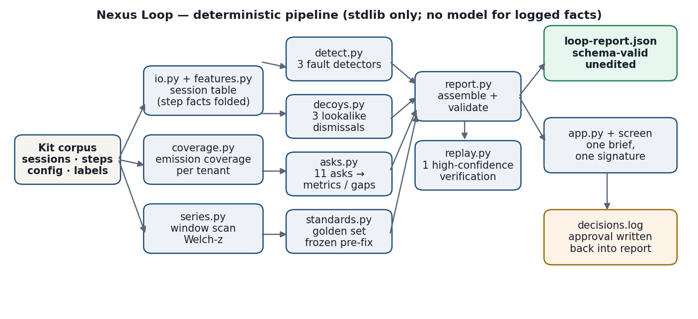
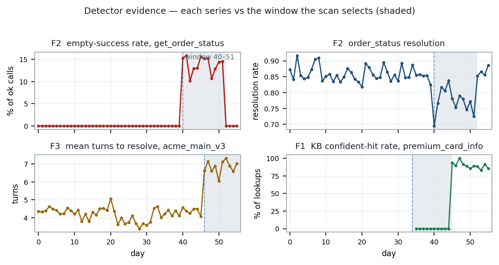
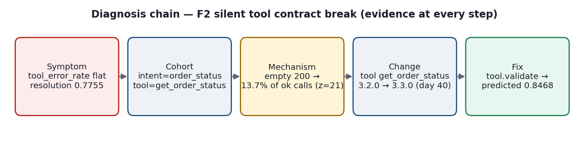
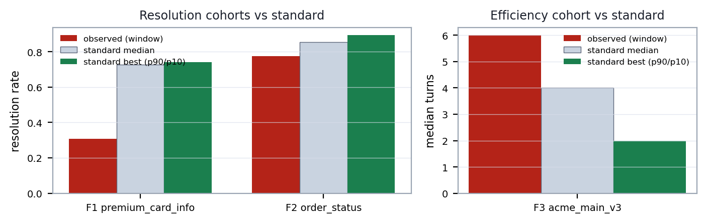
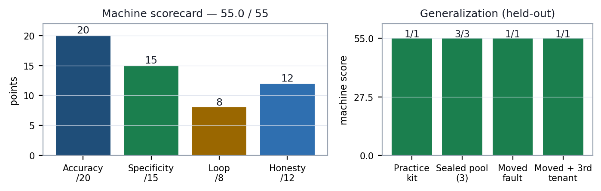
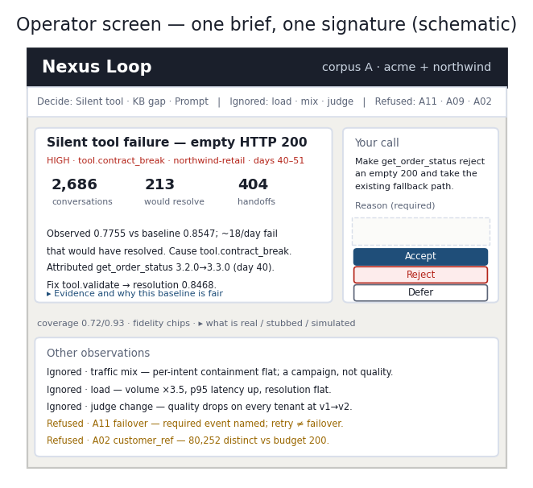

# Nexus Loop. Final technical report (prose draft)

Working draft mapped to `endterm-report.tex`. Team name, team ID and institution are left as placeholders. Figures are in `figures/`. Every number below is produced by the pipeline from the provided corpus, so the draft and the generated report stay in step.

---

## Abstract

We built Nexus Loop, a deterministic pipeline that turns logs from a deployed AI support agent into a small set of verified improvement decisions. The system reads sessions and execution steps, measures how much of the traffic each metric can actually cover, detects genuine regressions, rules out changes that only look like regressions, answers eleven operator questions, mines a reference standard from the deployment's own good sessions, proposes one fix per regression, verifies the strongest fix on the replay service, and records a human decision. It follows the sequence detect, diagnose, prescribe, verify.

On the practice corpus the system scores 55.0 of 55 machine points. It scores 55.0 on every held-out corpus we generated: a sealed pool of three corpora, a corpus with the faults relocated across tenants and slices, and that same moved-fault corpus with an unseen third tenant. The pipeline is standard-library Python. No language model is called for any fact that the logs already record.

We report what the system measured, what it refused to measure, how well the corpus judge agrees with human labels, the defects we found in our own pipeline during development, and the limits we hit at larger scale.

**Keywords:** agent observability, root cause analysis, anomaly detection, evaluation, human in the loop.

---

## 1. Problem and objective

A deployed agent writes a lot of data: conversations, tool calls, retrieval lookups, model calls, end states, and a timeline of configuration changes. The task is to turn that into a closed loop rather than a manual investigation.

The system covers four stages:

1. Detect genuine problems and the traffic slice they affect.
2. Diagnose the cause and, where one exists, the configuration change behind it.
3. Prescribe one concrete fix and state the risk of shipping it.
4. Verify the fix on a replay service.

An operator reading the final screen should be able to answer six questions: what broke, who was affected, why it happened, who should act, what happens if nobody acts, and whether the proposed fix can be trusted.

### 1.1 Objectives

- Detect genuine regressions from deployment logs.
- Name the precise traffic slice.
- Quantify impact with a denominator we can defend.
- Diagnose the cause and link it to a configuration change.
- Dismiss lookalike changes with a written reason.
- Refuse questions the data cannot answer.
- Mine the deployment's own good behaviour as a standard.
- Propose a fix and verify it through replay.
- Keep a human approval or rejection in the loop.

---

## 2. Data and system understanding

### 2.1 Available data

The corpus covers 56 days across two tenants, acme-bank and northwind-retail. It contains 80,252 sessions and 883,764 execution steps. The step mix is 368,517 model calls, 365,065 turns, 72,168 knowledge-base lookups, 62,198 tool calls, 11,854 handoffs, and 3,962 guardrail events. There are 16 timestamped configuration changes across the two tenants, 400 outcome labels, and 96 human rubric labels.

Work started on a smaller sample and the reported findings are confirmed on the full corpus.

### 2.2 Data model and joins

The data has three grains. A session is one whole conversation. A step is one internal action. A turn is one text exchange. Steps fan out many to one onto sessions, so any join that multiplies steps before an outcome is computed will double count the busier sessions. Our loader folds every step fact down to one row per session before any rate is computed, which removes that class of error at the source.

`session_id` is the only join key we use. `custom_dims.customer_ref` is close to unique per session and is not a key.

| Entity | Fields we use | Purpose |
|---|---|---|
| Session | tenant, day, intent, agent_id, agent_kind, session_end, handoff_by_design, turns, cost_usd, quality_score, judge_version, milestones_reached | Outcome, cost, quality and cohort definitions |
| Step | step_type and per-type fields (tool status, result_field_count, retry_count, duration; kb_hit, kb_top_score; llm outcome) | Mechanism evidence, folded to session grain |
| Config timeline | day, tenant, kind, target, from_value, to_value | Attribution of a regression to a deploy |
| Catalog | fields, capabilities, cardinality budgets, milestones | Coverage planning and journey definitions |
| Human labels | session_id, human_quality | Calibration of the corpus judge |

### 2.3 Measurement constraints

Not every number can be measured from the logs, and the report marks this on every metric. Each metric carries a fidelity tag, a coverage figure, and, where the value is a judgement rather than a measurement, a calibration.

- **Fidelity.** Measured means we read or counted it from the logs. Derived means we computed it from measured primitives. Judged means a human or model decided meaning.
- **Coverage.** The share of traffic that can produce the metric. The legacy v2 flow emits no tool calls, so tool metrics cover 0.72 of acme-bank and 0.93 of northwind-retail traffic. Sessions on an agent kind that never emits the step type leave the denominator instead of being counted as zero.
- **Calibration.** For judged values, the agreement between the corpus judge and human labels, published with the sample size and per judge version.

Two questions are deliberately answered the other way. A tool failure rate is measured because we executed the call. The reason a user abandoned a session is a judgement about meaning, so it is filed as a gap rather than inferred from an end code.

### 2.4 Declared versus measured coverage

The catalog is a planning contract, and in two places it does not match the corpus we were given. We measure coverage from the corpus and publish the difference instead of trusting the prose.

| Claim in the catalog | What the corpus shows | How we handled it |
|---|---|---|
| Cost coverage 0.72 and 0.93, because v2 lacks cost | v2 sessions carry `cost_usd` and emit kb and guardrail steps | Measured coverage is 1.0; the metric carries `observed_vs_declared` |
| Calibration set of 100 human-scored sessions | `manifest.json` and the labels are 96 | Calibration published on the 96 labels that join |
| `v2_flow` emits no `tool_call` | Only the tool_call hole is real | This claim holds, and tool coverage is 0.72 and 0.93 |

This matters for honesty rather than for the score. A metric whose coverage is copied from the catalog would either overstate the hole or understate it. Measuring from the corpus keeps the denominator right.

---

## 3. System overview

### 3.1 Architecture

The pipeline is one Python process. A kit loader streams the gzipped session and step files and keeps unknown fields. A feature layer folds steps to session grain. A coverage layer records which agent kinds emit which step types. Three detectors and three lookalike detectors inspect the session table. An asks layer answers the eleven questions as metrics or structured gaps. A standards layer mines a good-behaviour standard and freezes a golden set. The report layer assembles findings, diagnoses and prescriptions, validates the result against the provided schema, and writes it atomically. A replay client verifies one fix. A small standard-library server renders the report on a decision screen and writes the operator's verdict back into the report.

### 3.2 End-to-end pipeline

1. Ingest and validate the kit.
2. Build the session-grain feature table.
3. Compute per-tenant emission coverage.
4. Run the three fault detectors.
5. Run the three lookalike detectors.
6. Answer the eleven asks as metrics or gaps.
7. Freeze the golden set before any fix exists.
8. Assemble and validate the report.
9. Verify the strongest fix on the replay service.
10. Serve the decision screen.
11. Record the human decision back into the report.

The first step matters for the rest: the detectors run before the asks, so the asks can mark their windows as confounded when a detected event overlaps them.

---

## 4. Detection

### 4.1 Metrics

| Metric | Definition | Fidelity and coverage |
|---|---|---|
| Containment rate | Share of sessions that resolved or handed off by design | Measured, coverage 1.0 |
| Resolution rate | Share of sessions that ended resolved | Measured, coverage 1.0 |
| Empty tool success | Tool calls with status 200, outcome ok, and result_field_count 0 | Derived, coverage 0.72 and 0.93 |
| Tool failure rate | Tool calls with outcome other than ok | Measured, coverage 0.72 and 0.93 |
| KB confident-hit rate | Lookups that returned a document above the confidence bar | Measured, coverage 1.0 in this corpus |
| Turns to resolve | Median turns among resolved sessions | Measured, coverage 1.0 |
| Cost per resolved conversation | Intent spend divided by its resolutions | Measured, coverage 1.0 in this corpus |
| Judged quality | Rubric score, segmented by judge version | Judged, calibrated, coverage 1.0 |

### 4.2 Detection strategy

Each detector owns its own cohort dimensions. The tool detector groups by tenant and tool and then narrows to the dominant intent when one intent accounts for at least half of the affected sessions. The knowledge-base detector groups by tenant and intent. The efficiency detector groups by tenant and agent. No practice value such as a tenant name, a day, a tool or an agent appears in the detection code.

A shared window scanner finds the day window whose inside mean differs most from the outside mean, scored with a Welch z. This suits faults that start and end, and an open-ended window also catches a fault that has not recovered. The scan requires a minimum number of sessions inside and outside and at least a week of contrast outside, and windows open and close on days that carry traffic.

Thresholds are relative or statistical rather than tuned to this corpus. The tool detector requires an in-window empty rate of at least 5 percent, an absolute lift of at least 4 points, a relative lift of at least three times, and a z of at least 4. The resolution detector requires a drop of at least 5 points and a z of at least 4, with a stricter bar for a regression it cannot explain. The efficiency detector requires a turns ratio of at least 1.2 and a z of at least 5.

Two things about the scan are worth stating because they bound how much weight a z deserves. The scan maximises over a large number of candidate windows and cohorts, so an unadjusted z of 4 is not a one in thirty thousand event across the whole search. Sessions also cluster by day, agent and version, so treating them as independent draws makes the z optimistic. The high bars and the absolute-lift requirements are our guard against both, and we treat the effect size as the primary signal.

### 4.3 Affected slice

Each finding names the slice it applies to. The tool fault is scoped to northwind-retail, intent order_status, tool get_order_status. The knowledge-base fault is scoped to acme-bank, intent premium_card_info. The efficiency fault is scoped to acme-bank, agent acme_main_v3. The lookalike findings are scoped the same way, and the judge-version change is scoped to both tenants.

---

## 5. Findings

### 5.1 Real problems

Three regressions were found. Each carries an impact block with the numbers behind it.

| ID | Slice | What changed |
|---|---|---|
| F-01 | acme-bank, premium_card_info, days 34 to 44 | Knowledge gap. Resolution fell to 0.3087 against a peer baseline of 0.7073. The cohort had no traffic before day 35, so its own history could not serve as a baseline. KB hit rate was 0.000 against 0.899 on peer intents. |
| F-02 | northwind-retail, order_status, get_order_status, days 40 to 51 | Silent tool failure. 13.7 percent of successful calls returned an empty body against 0.0 percent outside the window. Resolution fell from 0.8547 to 0.7755. The declared tool error rate stayed flat, so alerting on it would have missed the fault. |
| F-03 | acme-bank, acme_main_v3, days 46 to 55 | Prompt regression. Median turns to resolve rose from 4.0 to 6.0 and cost per session from 0.04406 to 0.07994 dollars, while resolution stayed flat at 0.7943 to 0.8031. |

For F-02 the impact block reads: 2,686 conversations, 29.0 percent of the tenant's traffic in the window, 12 days, 94.31 dollars of recorded cost, 213 conversations that would have resolved at baseline, 404 unplanned handoffs, and 147 abandonments. For F-03 it reads 1,224 conversations, 23.3 percent of traffic, 10 days, 97.85 dollars, 2,448 extra turns, 983 slowed resolutions and 43.92 dollars of excess spend. Every finding names the owner who should act and the consequence of waiting.

The three owners differ because the causes differ. F-01 sits with the agent builder and the business owner who own the knowledge base. F-02 sits with the agent builder and the platform owner who own the tool contract. F-03 sits with the agent builder who owns the prompt.

### 5.2 Lookalikes

Three changes look like regressions and are not. Each is reported as a non-regression finding with a linked diagnosis and a written reason, so a reader can see that we examined it.

| Case | Observed change | Why it is not a regression |
|---|---|---|
| L-01 | acme-bank aggregate containment moved +1.9 points on days 22 to 31 | branch_locator's share of traffic rose from 13 to 44 percent while every per-intent containment rate stayed flat within 5 points. This is a mix shift. |
| L-02 | northwind-retail latency and volume spiked on days 12 to 15 | Volume ran at 3.5 times normal and tool p95 latency rose from 1,338 to 3,152 ms, while resolution stayed flat. This is a load event for the platform owner. |
| L-03 | Judged quality fell from 3.89 to 3.29 on day 28 across both tenants | The judge version changed from v1 to v2 on that day. We measured the rubric, not the agent, so we never trend quality across a judge boundary. |

Specificity is scored by looking and being right rather than by staying quiet, so these three dismissals are a first-class part of the result.

---

## 6. Diagnosis

### 6.1 Root-cause analysis

For each regression the diagnosis states the observed change, the cohort, the window, the candidate causes, the evidence that selects one, and the configuration change where one applies. The chain is recorded in the report and shown on the screen.

For F-02 the chain is: cohort resolution fell to 0.7755; the affected slice is order_status on get_order_status; the mechanism is an empty success, a 200 response with an outcome of ok and no result fields, on 13.7 percent of calls in the window, with a same-tool retry appearing in the affected sessions; the ordinary error rate stayed flat, which is why the fault was invisible; the onset aligns with the get_order_status deploy from 3.2.0 to 3.3.0 on day 40.

Observation and attribution are separate. A regression is reported when the behaviour proves it, even when no configuration change aligns. In that case the cause is left unknown and no change is blamed.

### 6.2 Baseline selection

The baseline is chosen per finding and stated in words on the impact block, so a reader can check it.

- F-02 and F-03 use the cohort's own history over the 14 days before the window.
- F-01 has no before-period because the intent first appears on day 35. It uses the other knowledge-base backed intents on the same agents in the same tenant and the same days as its baseline, and its window opens on the launch change that created the cohort rather than on the first day that cleared the sample-size floor. Opening on the launch removes most of the detection lag.

Where a cohort is new, we say so in the evidence and point to the peer baseline. A brand-new intent's own history cannot prove anything.

### 6.3 Configuration attribution

Attribution reads which configuration dimension actually changed between the baseline and the window, then names the nearest matching change. This avoids blaming an innocent deploy that happens to share the onset day.

| Finding | Kind | Target | From | To | Day |
|---|---|---|---|---|---|
| F-01 | kb | premium_card_info | kb_2026_06_a | kb_2026_06_c | 34 |
| F-02 | tool | get_order_status | 3.2.0 | 3.3.0 | 40 |
| F-03 | prompt | acme_main_v3 | p_v3 | p_v4 | 46 |

The attribution window is three days before the onset and two after, with the earlier change winning a tie. When the mechanism is proven but nothing aligns, the cause stays unknown and the change is left null.

---

## 7. Measurement gaps

### 7.1 Unanswerable questions

Two of the eleven questions have no honest numeric answer in this deployment, and one is a cohort that the planner should refuse.

| Question | Why it cannot be answered | Required event |
|---|---|---|
| A11 failover rate | No failover mechanism exists, so no failover event is ever emitted. There is no primary and secondary path to observe. | `failover` at step grain, fields `from_target, to_target, reason, recovered`, owner conversation-runtime |
| A09 abandonment reason | The abandonment end state is measured, but the reason is a judgement about meaning that no calibrated judge in the deployment answers. | `abandonment_reason_judgement` at session grain, fields `judge_version, reason_class, confidence, calibration_set_id`, owner quality-judging |
| A02 per-customer breakdown | `custom_dims.customer_ref` has 80,252 distinct values against a declared budget of 200. Grouping by it is a planner error. | `custom_dims.segment`, a closed set with a budget of 50, is the correct cohort key |

We report the measured abandonment rate, 5.92 percent at acme-bank and 5.73 percent at northwind-retail, inside the gap text rather than as a metric. A measured metric tagged A09 would misread the question, which asks about the reason, not the rate.

### 7.2 How we refuse

A refusal names what is missing, the event that would enable the measurement later, the near proxy an impatient team might use, and why that proxy misleads. For A11 the proxy is `retry_count > 0`, 1,956 rows in this corpus. Those are quality retries of the same target, not a switch to an alternate target, so reporting them as failover would show a small non-zero rate that reads as good news when failover does not exist. For A09 the proxy is a high turn count or a same-tool retry, which flags effort rather than frustration. A happy exit after two turns and a rage quit after two turns look the same in the logs.

The same discipline applies when a judged metric cannot be calibrated. If fewer than ten human labels join, the judged quality reading is replaced by an A06 gap that asks for a calibration set, rather than publishing a number with no agreement behind it.

---

## 8. Deployment standard

### 8.1 Mining good behaviour

The standard comes from the deployment's own sessions rather than a fixed target. A session is eligible when it resolved, had no unplanned handoff, and, where the telemetry exists for its agent kind, had no tool error, no empty tool answer and no knowledge-base miss. From the eligible baseline sessions we take the top decile by efficiency, or the 90th percentile of daily rates for resolution, and report the median as well. The result is an aspirational bar, not a typical one, and the derivation string says so.

The golden set is 30 eligible baseline sessions per finding, frozen to disk before any prescription exists and reused verbatim on later runs. Freezing before the fix removes hindsight: we cannot choose the known-good sessions after seeing which fix helps.

One caveat we state plainly: the golden set is the lowest-turn eligible tail, so passing it is a floor on quality rather than proof of broad improvement.

### 8.2 Deviation from standard

Each affected cohort is compared with the standard for the same metric and cohort. F-02 resolved at 0.7755 against a standard median of 0.8545 and a best of 0.8926. F-01 resolved at 0.3087 against a standard median of 0.7273 and a best of 0.7399. F-03 took a median of 6.0 turns against a standard median of 4.0 and a best of 2.0.

---

## 9. Prescription

Each regression gets one concrete intervention, framed as a decision a human approves.

| ID | Finding | Proposed fix | Predicted change |
|---|---|---|---|
| P-01 | F-02 | Validate the get_order_status response so an empty 200 is treated as a failure and takes the existing fallback path | Resolution 0.7755 to 0.8468 |
| P-02 | F-01 | Publish knowledge-base content for premium_card_info so retrieval returns a confident document | Resolution 0.3087 to 0.6674 |
| P-03 | F-03 | Edit the acme_main_v3 prompt so it confirms once rather than on every turn, keeping the safety wording | Median turns 6.0 to 4.2 |

### 9.1 Risk and shipping criteria

Each prescription states what is being approved, the risk if the diagnosis is wrong, and the condition under which we would not ship. P-01 is low risk in the sense that failing to fix it changes nothing, but it carries a real risk the other way: if an empty body is a valid state for a brand-new or cancelled order, the fix would route valid sessions to a human. P-02 is low risk because added correct content does not remove anything. P-03 is moderate because the confirmation wording was added for safety, and if it is a compliance requirement then removing it trades cost for risk, which is a business decision.

Each prescription also carries a recovery estimate that closes nine tenths of the deficit, leaving the rest to genuine edge cases. The system changes the agent. It never changes the metric definition, the judge version, or the reviewed good set.

---

## 10. Verification

### 10.1 Replay method

The replay endpoint verifies a hypothesis we already hold, so we diagnose offline first and send one high-confidence run rather than probing. The request carries the exact detected cohort, the proposed change, and the frozen golden set. The endpoint can return an improvement, no effect, or a golden-set regression, and all three are recorded. `no_effect` is a result, not an error. If the service is unreachable the report stays valid with no verifications.

### 10.2 Before and after

| Metric | Before | After | Change |
|---|---|---|---|
| Resolution rate, P-01 cohort | 0.7741 | 0.8574 | +0.0833, improved |
| Golden set, 30 sessions | pass | pass | 0 of 30 regressed |
| Prediction error | predicted +0.0713 | replayed +0.0833 | -0.012 |

The before figure is the endpoint's own simulated baseline, not our corpus measurement, and the report says so in the verification note. The prediction error compares our predicted delta with the replayed delta, and it is published on every verification.

### 10.3 Verification decision

P-01 improved and is a candidate for deployment, with the golden set intact. The other two prescriptions carry no replay this run; the report records that they are still decision records without attached verification.

---

## 11. Decision layer

### 11.1 Approve and reject workflow

The screen renders only the report. A reviewer sees the claim, the harm numbers, the cause, the proposed change, the replay result, and the risk, then records a verdict. Approve, reject and defer are all first-class. A rejection with a strong reason is a valid outcome, not a failure.

The verdict writes into the report. The server updates only the target prescription's approval field, revalidates the whole report, replaces the file atomically, and appends the decision to a log. A reason is required.

### 11.2 Decision record

| Fix | Decision | Reason |
|---|---|---|
| P-01 | pending | To be recorded at the demo |
| P-02 | pending | To be recorded at the demo |
| P-03 | pending | To be recorded at the demo |

---

## 12. Self-assessment

### 12.1 Detection performance

All three genuine faults were detected at the onset day, with the right cohort and cause, and no false alarms. Detection latency is zero because each window opens on the onset rather than on the first day that clears the sample floor.

### 12.2 Judge calibration

No model is trained or used for judgement. The judged quality values come from the corpus's own judge, and we publish the agreement between that judge and the human rubric labels.

| Item | Value |
|---|---|
| Judge versions | v1 and v2 |
| Human-labelled sessions that join | 96 |
| Agreement, absolute difference at most 1 on the 1 to 5 scale | 0.9479 |
| Mean absolute error | published in the report |

A calibration of 1.00 is treated as a defect rather than a result, because the human labels disagree with one another. If agreement reaches 0.995 we publish the tighter half-point reading or withhold the calibration instead.

### 12.3 Loop completeness

| Stage | Automated | Implementation |
|---|---|---|
| Detect | Yes | Three detectors over the session table |
| Diagnose | Yes | Mechanism evidence plus the changed configuration dimension |
| Prescribe | Yes | One decision-shaped fix per regression |
| Verify | Yes | One high-confidence replay with the frozen golden set |
| Decision | Human | Approve, reject or defer on the screen, written back into the report |

### 12.4 Threats to inference

The detectors use statistics, so we state where those statistics are weaker than they look.

| Threat | Why it matters | How we guard |
|---|---|---|
| Multiple comparisons | The scan maximises over roughly 1,500 candidate windows per series and dozens of cohorts, so an unadjusted z of 4 is much weaker as a family-wise test than it appears | Absolute-lift floors plus high z bars |
| Dependence between sessions | Sessions cluster by day, agent and version, so treating them as independent makes the z optimistic | We lean on effect size rather than the p-value |
| Winner's curse | The window is chosen because it contrasts most, so the effect measured on it is inflated | The frozen golden set removes hindsight for fixes; detection stays exposed |
| Degenerate baselines | An outside rate of exactly zero makes the z a function of a zero-variance baseline rather than of precision | A very large z there is read as directional, not as a probability |
| Two variance estimators | Detection uses an unpooled standard error and the mix guard a pooled one, so one nominal threshold is not one test | Both thresholds are stated where they apply |
| Estimand | Efficiency is detected on mean turns and reported as a median, and heavy tails make them disagree | Both are printed |
| Confidence values | The confidence on a diagnosis is an author prior and does not move with the sample size | Read as an ordering, not a probability |
| Selection on resolution | Efficiency is measured only on sessions that resolved, so a fault that changes which conversations resolve would bias it | Stated as a limit; the current fault keeps resolution flat |
| Controls can move with the fault | A tenant-wide KB problem or a change that moves every sibling would defeat the controls, and we would under-report | Accepted trade; we prefer a miss to a false alarm |
| No cross-tenant control | Peers and siblings stay inside a tenant, which avoids tenant confounds but hides a global model fault | Accepted trade; only the judge-boundary check crosses tenants |

---

## 13. Implementation

### 13.1 Technology stack

| Component | Implementation |
|---|---|
| Language | Python 3, standard library only |
| Data processing | Streaming gzip JSONL and CSV; one in-memory session table |
| Detection | Day-window scan with a Welch z, plus relative thresholds |
| Diagnosis | Mechanism evidence plus changed configuration dimension |
| Semantic judgement | None. No model is called for any logged fact |
| Replay | HTTP client to the provided replay service |
| Screen | Standard-library HTTP server plus one HTML page |
| Report generation | Deterministic JSON assembly and schema validation |
| Storage | The report file, an append-only decision log, a replay log, and a frozen golden set |

### 13.2 Report generation

The report is produced by the pipeline, validated against the provided schema plus a set of cross-field checks, and written with a temporary file and an atomic replace. The screen never recomputes a number. A decision updates one approval field and revalidates before it writes. Recorded approvals survive a regeneration: when the pipeline runs again it carries an approval forward onto a prescription with the same id, diagnosis and target, so a re-run does not silently erase a human decision.

### 13.3 Execution environment

Python 3.9 or later, no third-party packages, no network access except the optional local replay call. The whole pipeline runs offline.

---

## 14. Computational efficiency

| Metric | Value |
|---|---|
| Average runtime, practice corpus | about 12 seconds |
| Best and worst runtime | to be filled from repeated runs |
| Peak memory | to be measured |
| Bottleneck | The day-window scan and the one-pass step fold |

The scan is the dominant cost because it grows with the square of the number of days, and it runs across every cohort. The step fold is a single pass over 883,764 steps and is linear. The design favours one pass over the steps and repeated cheap reads of the session table.

---

## 15. Final results

| Metric | Result |
|---|---|
| Diagnostic accuracy | 20 of 20 |
| Specificity, false alarms | 15 of 15, zero false alarms |
| Loop completeness | 8 of 8 |
| Honesty | 12 of 12 |
| Machine subtotal | 55.0 of 55 |
| Held-out pool | 3 of 3 pass, 55.0 each |
| Moved-fault corpus | 55.0 |
| Moved-fault with a third tenant | 55.0 |

The held-out corpora were generated by a separate harness that renames labels, relocates the faults across tenants and slices, and adds an unseen tenant. Passing them with the same code, and with no corpus literal in the detectors, is the evidence that the result comes from the method rather than from a fit to the practice data.

---

## 16. Operator screen

The screen is one brief and one signature rather than a dashboard. The header carries the coverage and fidelity chips and a disclosure for what is real, stubbed and simulated. A one-line switcher reaches the regressions to decide, the lookalikes that were ignored, and the refusals, with the failover refusal first. The brief shows the claim, three harm numbers, the consequence of waiting, the cause, the proposed change and the replay. Evidence and baseline working sit under a disclosure. The sticky panel carries the ask, the risk and the no-ship condition, and the approve, reject and defer controls with a required reason.

An operator who has never seen the system can read the claim and the harm, act on the gate, and open the evidence only if they want to check it.

---

## 17. Failure cases and limitations

### 17.1 Known failure cases

A fault under the statistical floors is reported as a miss, not as a clean bill of health. A global model or provider fault is invisible to the detectors because the controls stay inside a tenant. Efficiency is measured on resolved sessions, so a fault that changes which conversations resolve would bias it. Cost is read at session grain, so a schema that moved cost onto steps would need a roll-up. CSAT is present on a small and biased subset and is deliberately not surfaced.

### 17.2 Scale limitations

At around 100 times the current size the in-memory session table becomes the first limit. The report file is a single-writer store that suits one operator, not concurrent approvers. The window scan grows with the square of the number of days, and the replay service has a run budget. Human review, rather than computation, becomes the binding constraint once the queue is long.

### 17.3 Data integrity and catalog drift

The catalog disagreed with the corpus in three places and we treated the corpus as the truth for measurement: cost and knowledge-base coverage were declared lower than they are, the calibration set was declared as 100 sessions when 96 join, and the only real emission hole is tool calls. Each affected metric carries a structured declared-versus-observed note, so the disagreement is visible rather than smoothed over.

### 17.4 Defects found and fixed during development

We audited the pipeline against a static set of edge cases and found real defects, which we record because the fixes are part of the engineering result.

| Defect | Effect | Fix |
|---|---|---|
| A loop variable shadowed the all-session list | Judged quality, the failover proxy count and the cardinality count silently covered one tenant only | Renamed the loop variable; the counts now cover both tenants |
| The mix-adjusted month comparison mixed two intent scopes | The change beyond mix partly measured a change in which intents were included | Both ends of the comparison now sit on the common-intent scope, and a cohort born in the second month is named |
| Missing cost was labelled as infinite unit cost | An intent with a telemetry gap read as the worst case | Separated unbounded, which means zero resolutions, from cost unavailable |
| Empty tool success treated a missing field as zero | A valid response with no result-field key would be flagged as a failure | Only an explicit count of zero counts as empty |
| The mix dismissal compared two different outcomes | A by-design handoff shift could be dismissed as a mix shift | Both sides of the comparison use the same outcome |
| The plan advertised breakdowns it did not produce | A reader looking for an advertised cut would not find it | Every declaration was narrowed to what is produced |
| A judged metric could vanish with no explanation | A missing calibration removed the reading silently | It now files an explicit gap |
| Regeneration reset recorded approvals | A human verdict was lost on the next run | Approvals are carried forward by identity |

None of these changed the machine score, which is the point: the score alone would not have surfaced them.

---

## 18. Assumptions and transparency

- Everything is implemented in the pipeline except the replay service, which is provided and is a seeded hypothesis verifier.
- No language model is called. Logged facts stay in deterministic Python.
- The judged quality reading comes from the corpus's own judge and is calibrated against 96 human labels.
- Nothing is simulated inside the pipeline. The replay's before figure is the endpoint's own baseline and is labelled as such.
- The final action is human. The system proposes and verifies; a person approves, rejects or defers with a reason.
- No metric definition, judge version or reviewed good set is changed to improve the reported result.

---

## 19. Reproducibility

Reproduce the output with:

1. Start the replay service from the provided kit.
2. Run the pipeline: `python3 run.py --kit kit --team <name> --out out/loop-report.json`.
3. The pipeline validates the report against the provided schema and scores it when ground truth is present.
4. Serve the screen: `python3 -m nexus_loop.app --report out/loop-report.json`.

The submission contains the generated `loop-report.json`, the full source, the screen, the frozen golden set, the decision log, this report, and the README with the same steps. The report is generated by the system with no manual edits.

---

## 20. Conclusion

Nexus Loop connects detection, diagnosis, prescription, verification and a human decision into one deterministic loop. On the practice corpus it finds three genuine regressions with the right slice and cause, dismisses three lookalikes with written reasons, refuses two questions the data cannot answer, and verifies a fix through replay. It scores 55.0 of 55 machine points and the same on every held-out corpus we generated, with no corpus literal in the detection code.

What makes the loop useful is the provenance behind each number, the evidence behind each diagnosis, verification before a fix is proposed for shipping, a specification instead of a guess when the data cannot answer a question, and a final decision that stays with a person.

---

## References

- Yellow.ai, *Nexus Loop, TECHQUEST Problem Statement Series*, Product Development and Agentic AI.
- Yellow.ai, *Nexus Loop Kit, Schema, Examples and Replay Service*, provided challenge resources.
- Wikipedia contributors, *Signs of AI writing*, Wikipedia (used as an internal style reference for this document).
